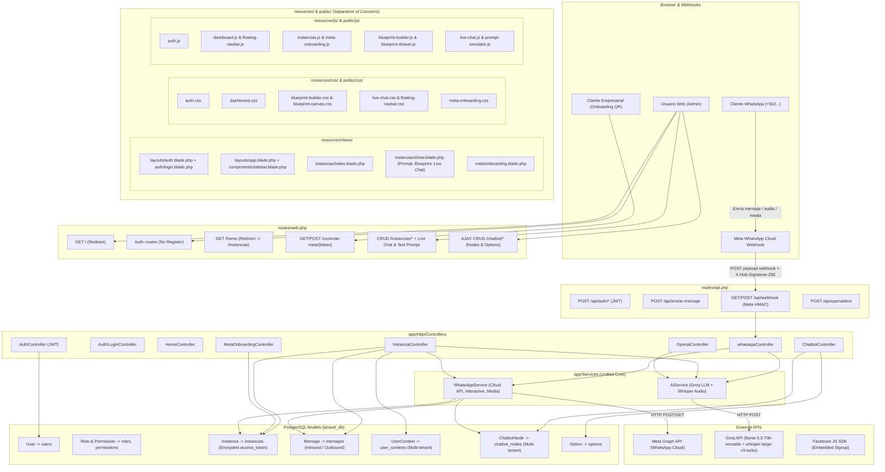

# Codebase Knowledge Graph — `chatbot-laravel-whatsapp`

This document maps all structural nodes, services, views, assets, and directed edges of the Laravel 12 (PHP 8.5) project so the AI agent can perform instant symbol lookup and blast-radius analysis.

---

## 1. Visual Architecture Graph (Mermaid)

---

## 2. Node Registry & File Locations

### Models & Database Schema (`app/Models/` & `database/migrations/`)
*Database Engine: PostgreSQL (`laravel_db`) — Runtime: PHP 8.5.12*

| Model | Table | Primary Key | Key Columns & Relations |
| :--- | :--- | :--- | :--- |
| `App\Models\User` | `users` | `id` (bigint) | `name`, `email`, `password`, `role_id` (FK -> `roles.id`), `JWTSubject` |
| `App\Models\Role` | `roles` | `id` (bigint) | `name` (unique), `display_name`, `description` |
| `App\Models\Permission` | `permissions` | `id` (bigint) | `name` (unique), `display_name`, `description` |
| `App\Models\Instancia` | `instancias` | `id` (bigint) | `nombre_empresa`, `phone_number_id` (unique), `waba_id`, `telefono`, `system_prompt`, `is_active`, `access_token` (encrypted via `Crypt`, hidden in JSON) |
| `App\Models\Mensaje` | `mensajes` | `id` (bigint) | `instancia_id` (FK), `whatsapp_id`, `from`, `to`, `body`, `type`, `media_url`, `direction` (`inbound`/`outbound`) |
| `App\Models\UserContext` | `user_contexts` | `id` (bigint) | `instancia_id` (FK), `phone_number`, `nombre`, `current_node`, `ai_history` (json), `is_bot_active`, `bot_paused_until` |
| `App\Models\ChatbotNode` | `chatbot_nodes` | `(instancia_id, id)` | `instancia_id` (FK -> `instancias.id` cascade), `id` (slug string), `mensaje`, `timestamps` |
| `App\Models\Option` | `options` | `id` (bigint) | `instancia_id` (FK -> `instancias.id` cascade), `chatbot_node_id` (composite FK -> `chatbot_nodes(instancia_id, id)` cascade), `key`, `text`, `respuesta` (json), `next_node_id` |

---

### Services (`app/Services/`) & Configuration (`config/services.php`)

| Service Class | File Path | Responsibilities & Outgoing Edges |
| :--- | :--- | :--- |
| `WhatsAppService` | [`app/Services/WhatsAppService.php`](file:///c:/proyect/chatbot-laravel-whatsapp/app/Services/WhatsAppService.php) | Unified Meta WhatsApp Cloud API service. Methods: `enviar()`, `enviarCloud()` (multi-tenant tokens, buttons/lists, outbound logging in `Mensaje`), `enviarMensajeDinamico()`, `descargarMedia()` (SSRF-safe CDN whitelist). Reads config from `config('services.whatsapp.*')`. |
| `AiService` | [`app/Services/AiService.php`](file:///c:/proyect/chatbot-laravel-whatsapp/app/Services/AiService.php) | Unified Groq AI provider (`llama-3.3-70b-versatile` & `whisper-large-v3-turbo`). Methods: `obtenerRespuesta()` (multi-tenant system prompt, conversation history, security guardrails), `transcribirAudio()`. Reads config from `config('services.groq.*')`. |

---

### Controllers (`app/Http/Controllers/`)

| Controller | File Path | Responsibilities & Handlers |
| :--- | :--- | :--- |
| `InstanciaController` | [`app/Http/Controllers/InstanciaController.php`](file:///c:/proyect/chatbot-laravel-whatsapp/app/Http/Controllers/InstanciaController.php) | CRUD multi-tenant instances, Meta test generator, Coexistence toggle, Live Chat incremental history, direct agent messaging, and AI prompt simulator (`index`, `show`, `store`, `update`, `destroy`, `generarDemo`, `toggleBot`, `chatHistorial`, `enviarMensajeDirecto`, `testPrompt`). Middleware: `auth, role:admin`. |
| `MetaOnboardingController` | [`app/Http/Controllers/MetaOnboardingController.php`](file:///c:/proyect/chatbot-laravel-whatsapp/app/Http/Controllers/MetaOnboardingController.php) | Embedded Signup & QR Onboarding (`generarToken`, `verificarEstado`, `landing`, `completar`). |
| `ChatbotController` | [`app/Http/Controllers/ChatbotController.php`](file:///c:/proyect/chatbot-laravel-whatsapp/app/Http/Controllers/ChatbotController.php) | Blueprint Node & Option CRUD (`index`, `show`, `storeNode`, `updateNode`, `destroyNode`, `storeOption`, `updateOption`, `deleteOption`). Middleware: `auth, role:admin`. |
| `whatsappController` | [`app/Http/Controllers/whatsappController.php`](file:///c:/proyect/chatbot-laravel-whatsapp/app/Http/Controllers/whatsappController.php) | Webhook & API endpoints (`verificarWebhook`, `recibirWebhook`, `recibirMensaje`, `enviarMensaje`, `enviarMensajeWhatsapp`, `enviarMensajeDinamico`, `funRespuestaIA`, `descargarMediaWhatsApp`, `transcribirAudioGroq`). Delegates core operations to `WhatsAppService` and `AiService`. |
| `AuthController` | [`app/Http/Controllers/AuthController.php`](file:///c:/proyect/chatbot-laravel-whatsapp/app/Http/Controllers/AuthController.php) | JWT authentication for external REST APIs (`login`, `me`, `logout`, `refresh`). |
| `OpenaiController` | [`app/Http/Controllers/OpenaiController.php`](file:///c:/proyect/chatbot-laravel-whatsapp/app/Http/Controllers/OpenaiController.php) | Direct testing endpoint for Groq AI responses (`funRespuestaIA`). |
| `HomeController` | [`app/Http/Controllers/HomeController.php`](file:///c:/proyect/chatbot-laravel-whatsapp/app/Http/Controllers/HomeController.php) | Redirects authenticated users to `instancias.index`. |

---

### Routes Web (`routes/web.php`)

| Method & URI | Target Handler | Middleware & Access |
| :--- | :--- | :--- |
| `GET /` | Closure | Redirects to `/instancias` (if logged in) or `/login` |
| `GET /conectar-meta/{token}` | `MetaOnboardingController@landing` | Public (404 if token expired) |
| `POST /conectar-meta/{token}/completar` | `MetaOnboardingController@completar` | Public |
| `GET/POST /login`, `POST /logout` | `Auth\LoginController` | Web Auth |
| `GET /home` | `HomeController@index` | `auth` (Redirects to `instancias.index`) |
| `POST /meta/onboarding-token` | `MetaOnboardingController@generarToken` | `auth, role:admin` |
| `GET /meta/onboarding-status/{token}` | `MetaOnboardingController@verificarEstado` | `auth, role:admin` |
| `CRUD /instancias/*` | `InstanciaController@*` | `auth, role:admin` |
| `GET /panel-contactos` | Closure | `auth, role:admin` (Redirects to `instancias.index`) |
| `CRUD /chatbot/*` | `ChatbotController@*` | `auth, role:admin` |

---

### Routes API (`routes/api.php`)

| Method & URI | Target Handler | Details |
| :--- | :--- | :--- |
| `POST /api/auth/login` | `AuthController@login` | Generates JWT Token (`throttle:5,1`) |
| `GET /api/auth/me`, `GET /api/user` | `AuthController@me` | Returns user info and roles/permissions (`auth:api`) |
| `POST /api/auth/logout` | `AuthController@logout` | Invalidates JWT Token (`auth:api`) |
| `POST /api/auth/refresh` | `AuthController@refresh` | Refreshes active JWT Token (`auth:api`) |
| `POST /api/enviar-mensaje` | `whatsappController@enviarMensaje` | Dispatches WhatsApp message (`auth:api, throttle:60,1`) |
| `GET /api/webhook` | `whatsappController@verificarWebhook` | Meta webhook challenge verification (`throttle:120,1`) |
| `POST /api/webhook` | `whatsappController@recibirWebhook` | Incoming WhatsApp messages with HMAC-SHA256 verification (`throttle:120,1`) |
| `POST /api/openai/text` | `OpenaiController@funRespuestaIA` | Direct AI response endpoint (`auth:api, throttle:15,1`) |
