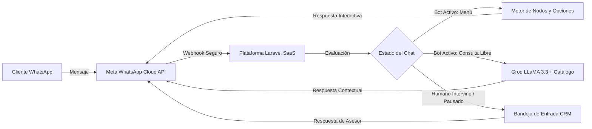
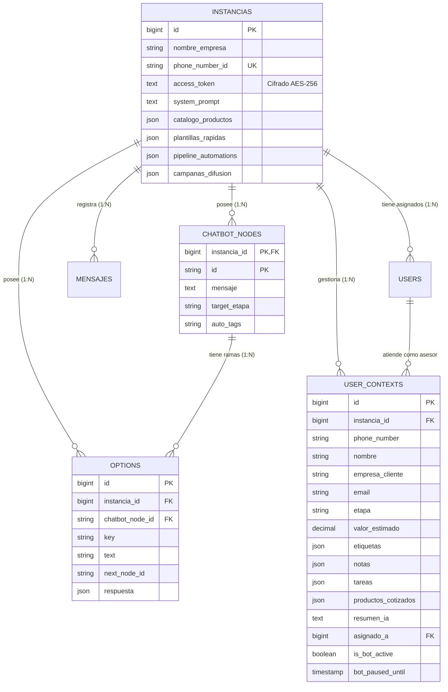
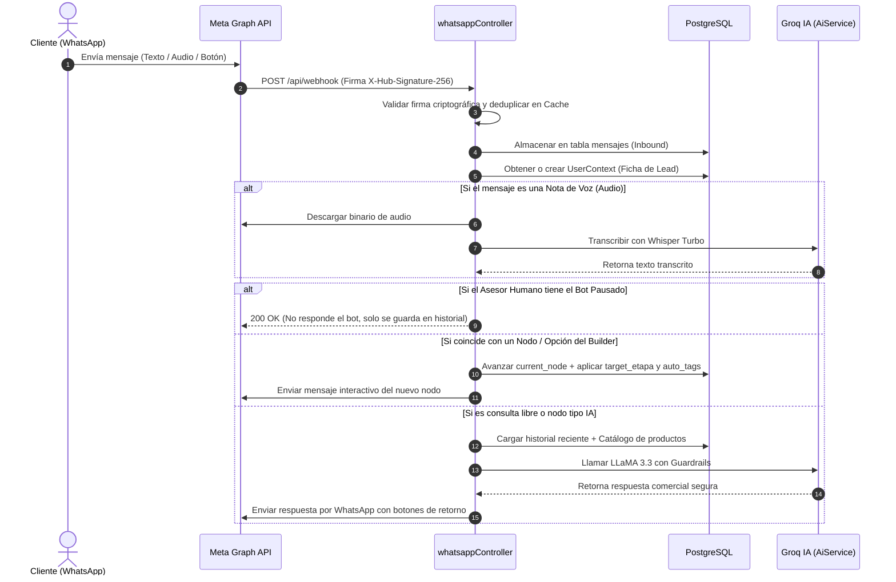

# 🗺️ Mapa Integral de Arquitectura, Auditoría de Funciones y Hoja de Ruta

> **Sistema SaaS Multi-Tenant de CRM Conversacional, Flujos Automatizados e Inteligencia Artificial para WhatsApp**  
> **Stack:** Laravel 12 (PHP 8.5) • PostgreSQL • Meta WhatsApp Cloud API (v22.0) • Groq Cloud API (LLaMA 3.3 70B & Whisper) • Vite / Clean SaaS JS

---

## 📑 Tabla de Contenidos
1. [Propósito y Visión del Sistema](#1-propósito-y-visión-del-sistema)
2. [Principios Clave: Aislamiento y Coexistencia](#2-principios-clave-aislamiento-y-coexistencia)
3. [Arquitectura General del Sistema](#3-arquitectura-general-del-sistema)
4. [Estructura del Proyecto y Archivos Críticos](#4-estructura-del-proyecto-y-archivos-críticos)
5. [Modelo de Base de Datos y Aislamiento Multi-Tenant](#5-modelo-de-base-de-datos-y-aislamiento-multi-tenant)
6. [Flujo de Mensajería y Webhooks (Ciclo de Vida)](#6-flujo-de-mensajería-y-webhooks-ciclo-de-vida)
7. [Motor de Inteligencia Artificial y Guardrails](#7-motor-de-inteligencia-artificial-y-guardrails)
8. [Los 7 Módulos de la Suite CRM](#8-los-7-módulos-de-la-suite-crm)
9. [Seguridad, Cifrado y Acceso Híbrido](#9-seguridad-cifrado-y-acceso-híbrido)
10. [Matriz Completa de Funcionalidades (Cubiertas vs. Hoja de Ruta)](#10-matriz-completa-de-funcionalidades-cubiertas-vs-hoja-de-ruta)

---

## 1. Propósito y Visión del Sistema

El software es una plataforma **B2B SaaS Multi-Empresa** diseñada para automatizar y escalar la atención comercial y de soporte en WhatsApp:
- Cada empresa cliente tiene su propia **Instancia** de WhatsApp conectada (vía Meta WhatsApp Cloud API).
- El sistema atiende automáticamente a múltiples clientes en paralelo mediante **Flujos Visuales (Nodos)** y un **Agente de IA** entrenado con las instrucciones y catálogo de productos propios de cada empresa.
- El equipo humano de la empresa puede supervisar en vivo, gestionar oportunidades en un tablero Kanban y tomar el control manual de cualquier conversación sin colisionar con el bot.



---

## 2. Principios Clave: Aislamiento y Coexistencia

### 2.1. Aislamiento Multi-Tenant Estricto (Zero Leakage)
1. **Contexto individual por cliente y por empresa:** Si 30 personas escriben el mismo día, son 30 contextos independientes (`user_contexts`) aislados por `(instancia_id, phone_number)`. Jamás se mezclan conversaciones entre clientes ni entre empresas distintas.
2. **Independencia total de nodos y datos:** Si se borra o edita un nodo, opción, producto o prompt en una instancia (incluida la instancia de prueba), las demás instancias **no se ven afectadas**.
3. **Claves compuestas a nivel de motor PostgreSQL:**
   - `chatbot_nodes` tiene clave primaria compuesta `(instancia_id, id)`.
   - `options` tiene clave foránea compuesta `(instancia_id, chatbot_node_id)` con `ON DELETE CASCADE`.
4. **Cero datos hardcodeados:** La base de datos y el código no contienen menús, prompts ni productos pregrabados; cada instancia parte limpia para ser entrenada según las reglas de esa empresa.

### 2.2. Coexistencia Híbrida (Bot + Asesor Humano)
- **Intervención desde el CRM Web:** Cuando un asesor envía un mensaje desde la Bandeja Unificada o presiona el botón **Bot Activo / Pausar** (`toggleBot`), el bot se pausa para ese cliente.
- **Intervención desde el celular físico (WhatsApp Business App):** El webhook procesa eventos `smb_message_echoes` / `message_echoes`, registra el mensaje saliente en el historial del CRM, mueve el lead a la etapa `asesor` y pausa el bot automáticamente.
- **Solicitud de humano por el cliente:** Si el cliente escribe *"asesor"*, *"humano"*, *"agente"* o pulsa el botón interactivo *"Hablar con asesor"*, el bot se pausa y transfiere el caso.
- **Reactivación manual o automática:** El asesor puede reactivar el bot con un clic en la bandeja, o el cliente puede reactivarlo escribiendo *"Hola"*, *"Menú"* u *"Opciones"*.

---

## 3. Arquitectura General del Sistema

```mermaid
flowchart TD
    subgraph Frontend["Frontend (Blade + CSS Modular + Vanilla JS Moderno)"]
        Nav[Barra de Navegación Flotante 7 Módulos]
        Kanban[Tablero Kanban de Embudo Drag & Drop]
        Chat[Bandeja Unificada 3 Columnas]
        Inspector[Ficha Lead 360° + Cotizador]
        Builder[Constructor Visual de Flujos Canvas]
        Tasks[Centro de Tareas y Agenda To-Do]
        Lists[Directorio, Catálogo y Difusión]
    end

    subgraph Backend["Backend (Laravel 12)"]
        InstController[InstanciaController]
        WaController[whatsappController]
        ChatbotCtrl[ChatbotController]
        MetaCtrl[MetaOnboardingController]
        AiServ[AiService (Groq Cloud API)]
        WaServ[WhatsAppService (Meta Graph API)]
    end

    subgraph Storage["Persistencia (PostgreSQL)"]
        T_Instancias[(instancias)]
        T_Nodes[(chatbot_nodes)]
        T_Options[(options)]
        T_Contexts[(user_contexts)]
        T_Messages[(mensajes)]
        T_Users[(users & roles)]
    end

    Frontend <--> Backend
    Backend <--> Storage
```

---

## 4. Estructura del Proyecto y Archivos Críticos

### 4.1. Controladores (`app/Http/Controllers/`)
- [`InstanciaController.php`](file:///c:/proyect/chatbot-laravel-whatsapp/app/Http/Controllers/InstanciaController.php): Orquesta la Suite CRM (Dashboard, Kanban, Bandeja 3 columnas, creación manual de leads, exportación CSV, notas, tareas, cotizador, catálogo de productos, plantillas rápidas `/atajo`, automatizaciones por etapa, difusión masiva y cuentas de usuario por empresa).
- [`whatsappController.php`](file:///c:/proyect/chatbot-laravel-whatsapp/app/Http/Controllers/whatsappController.php): Receptor del webhook de Meta WhatsApp. Verifica firma HMAC SHA-256, evita ataques de repetición (replay cache), descarga multimedia, transcribe audios con Whisper, ejecuta nodos de acción (`target_etapa`, `auto_tags`) y enruta consultas al motor de IA.
- [`ChatbotController.php`](file:///c:/proyect/chatbot-laravel-whatsapp/app/Http/Controllers/ChatbotController.php): CRUD AJAX de nodos y opciones aislado por `instancia_id`.
- [`MetaOnboardingController.php`](file:///c:/proyect/chatbot-laravel-whatsapp/app/Http/Controllers/MetaOnboardingController.php): Flujo de vinculación mediante QR y enlace único con Meta Embedded Signup.

### 4.2. Servicios (`app/Services/`)
- [`WhatsAppService.php`](file:///c:/proyect/chatbot-laravel-whatsapp/app/Services/WhatsAppService.php): Cliente de Meta Graph API v22.0 con soporte para texto, botones interactivos (1-3 opciones), listas desplegables (4-10 opciones), imágenes, documentos, audio, ubicación y validación de dominios CDN de Meta (`lookaside.fbsbx.com`, `scontent.whatsapp.net`, `*.fbcdn.net`).
- [`AiService.php`](file:///c:/proyect/chatbot-laravel-whatsapp/app/Services/AiService.php): Integración con Groq Cloud API (`llama-3.3-70b-versatile` y `whisper-large-v3-turbo`) con Guardrails de seguridad, Copiloto CRM (resumen ejecutivo, sugerencia de respuesta, cambio de tono) y detección de intención comercial.

### 4.3. Modelos (`app/Models/`)
- [`Instancia.php`](file:///c:/proyect/chatbot-laravel-whatsapp/app/Models/Instancia.php): Incluye cifrado automático AES-256 en reposo para `access_token` (`Crypt::encryptString` / `Crypt::decryptString`).
- [`UserContext.php`](file:///c:/proyect/chatbot-laravel-whatsapp/app/Models/UserContext.php): Define las 6 etapas del embudo (`nuevo`, `calificado`, `cotizacion`, `asesor`, `ganado`, `perdido`), relación `asesorAsignado()` y atributos JSON del lead.
- [`ChatbotNode.php`](file:///c:/proyect/chatbot-laravel-whatsapp/app/Models/ChatbotNode.php) y [`Option.php`](file:///c:/proyect/chatbot-laravel-whatsapp/app/Models/Option.php): Árbol de flujos por instancia.
- [`Mensaje.php`](file:///c:/proyect/chatbot-laravel-whatsapp/app/Models/Mensaje.php): Registro de mensajes `inbound` y `outbound`.
- [`User.php`](file:///c:/proyect/chatbot-laravel-whatsapp/app/Models/User.php): Control de permisos `isAdmin()`, `isEmpresa()` y `canAccessInstancia()`.

---

## 5. Modelo de Base de Datos y Aislamiento Multi-Tenant



---

## 6. Flujo de Mensajería y Webhooks (Ciclo de Vida)



---

## 7. Motor de Inteligencia Artificial y Guardrails

1. **Delimitación XML (`<consulta_cliente>`):** Protege contra Prompt Injection aislando el texto externo de las directivas del sistema.
2. **Inyección Dinámica de Catálogo:** El catálogo de productos de la instancia (SKU, nombre, categoría, precio, descripción) se inyecta en tiempo real al contexto de la IA.
3. **Filtro de Salida (`filtrarSalidaSegura`):** Bloquea cualquier intento de filtrar claves (`APP_KEY`, `GROQ_API_KEY`, `gsk_`, `EAA`) o instrucciones internas.
4. **Copiloto para Asesores Humanos:**
   - **Resumen Ejecutivo (`iaResumen`):** Síntesis de 3 puntos (Interés, Contexto, Acción recomendada).
   - **Sugerir Respuesta (`iaSugerir`):** Redacción de respuesta comercial basada en los últimos 12 mensajes y el prompt de la empresa.
   - **Reescritura de Tono (`iaTono`):** Transforma el borrador del asesor a tono Ejecutivo, Amigable, Cierre de Ventas o Conciso.

---

## 8. Los 7 Módulos de la Suite CRM

1. **Dashboard & Analítica (`#pane-dashboard`):** Tarjetas KPI, embudo de conversión visual por etapa con barras de progreso y suma monetaria (`#crm-dashboard-funnel`), y feed de actividad en vivo.
2. **Embudo Digital Kanban (`#pane-pipeline`):** 6 columnas (`Nuevos Leads`, `En Atención (Bot)`, `En Cotización`, `Requiere Asesor`, `Venta Ganada`, `Perdido / Cerrado`), Drag & Drop con persistencia AJAX, filtros por estado Bot/Humano y modal de **Automatizaciones del Embudo Digital** (enviar WhatsApp automático, etiquetar, crear tarea o pausar/activar bot al entrar a una etapa).
3. **Bandeja Unificada 3 Columnas (`#pane-chats`):**
   - *Izquierda:* Lista de conversaciones con búsqueda y filtros rápidos (`Todos`, `Humano`, `Cotización`, `Con Tareas`, `Bot`).
   - *Centro:* Chat en tiempo real con soporte multimedia, barra de Copiloto IA, autocompletado de plantillas rápidas con `/` y botón manual para pausar/reactivar el bot.
   - *Derecha:* Inspector 360° con dos pestañas: **Principal 360°** (nombre, empresa, email, etapa, presupuesto, etiquetas, tareas y notas internas) y **Productos / Cotización** (vincula ítems del catálogo y recalcula automáticamente el `valor_estimado` del lead).
4. **Centro de Tareas y Agenda (`#pane-tareas`):** Creación y seguimiento global de tareas (`seguimiento`, `llamada`, `reunión`, `cotización`) con filtros de pendientes, completadas y todas.
5. **Listas CRM (`#pane-listas`):**
   - *Contactos y Empresas:* Directorio tabular con buscador y botón **Exportar Excel / CSV**.
   - *Catálogo de Productos:* Gestión de SKU, nombre, categoría, precio y descripción.
   - *Plantillas Rápidas (`/atajos`):* Comandos rápidos con variables `{{nombre}}` y `{{telefono}}`.
   - *Difusión Masiva (Broadcasts):* Envío masivo segmentado por etapa del embudo y/o etiqueta con historial de campañas.
6. **Constructor Visual de Flujos (`#pane-nodos`):** Lienzo interactivo con zoom, pan, auto-layout, conexiones SVG y panel lateral con acciones automáticas de embudo por nodo (`target_etapa`, `auto_tags`).
7. **Entrenamiento del Agente IA (`#pane-prompt`):** Editor del `system_prompt` por instancia.

---

## 9. Seguridad, Cifrado y Acceso Híbrido

- **Cifrado de Credenciales en Base de Datos:** El campo `access_token` de `Instancia` se cifra automáticamente con AES-256 (`Crypt::encryptString`) antes de guardarse en PostgreSQL.
- **Cabeceras de Seguridad HTTP (`SecurityHeadersMiddleware`):** Aplica globalmente `X-Frame-Options`, `X-Content-Type-Options`, `Referrer-Policy` y `Content-Security-Policy`.
- **Rate Limiting:** Protección contra fuerza bruta en login (`ThrottlesLogins`), endpoints de onboarding (`throttle:15,1` y `throttle:5,1`) y API.
- **Acceso Híbrido por Roles (`RoleMiddleware`):**
  - `admin`: Control total de instancias, flujos, prompts y usuarios.
  - `empresa`: Acceso exclusivo al CRM de su instancia asignada (`Dashboard`, `Embudo`, `Chats`, `Tareas`, `Listas`), con creación y revocación de cuentas desde el modal de Ajustes de la instancia.

---

## 10. Matriz Completa de Funcionalidades (Cubiertas vs. Hoja de Ruta)

### 10.1. Ya implementadas en el código actual (`[x]`)
- [x] **Contactos, Leads y Campos Personalizados:** Ficha 360° (nombre, teléfono, correo, empresa), **campos personalizados dinámicos por empresa** (`texto`, `numero`, `fecha`, `lista`, `casilla`), etiquetas, notas internas en la ficha, historial completo, creación manual de leads, propietario asignado (`asignado_a`), directorio general con búsqueda y exportación a CSV/Excel.
- [x] **Pipeline Kanban Configurable:** Tablero Drag & Drop, **etapas personalizables por empresa** (crear, renombrar, cambiar color, eliminar o restaurar por defecto), etapas finales fijas **"Venta Ganada"** (`ganado`) y **"Perdido / Cerrado"** (`perdido`), **motivo de pérdida obligatorio** (`motivo_perdida`) al cerrar como perdido, valor monetario por lead y suma por columna, indicadores en tarjeta (mensajes sin leer, asesor asignado, estado Bot/Humano, tareas pendientes, nodo actual, etiquetas, tiempo), filtros del tablero y disparadores automáticos al cambiar de etapa.
- [x] **Bandeja de Entrada y Flujo de Equipo:** Vista de 3 columnas, **estados de conversación** (`abierta`, `pendiente`, `resuelta`), **contador de mensajes sin leer** (`mensajes_sin_leer`) con limpieza automática al abrir el chat, **asignación/transferencia de chats a asesores** (`asignado_a`), **notas internas dentro del hilo de chat** (`direction = 'internal_note'`, invisibles para el cliente), envío directo de WhatsApp, plantillas rápidas con atajo `/`, filtros rápidos (`Todos`, `Sin Leer`, `Humano`, `Cotización`, `Con Tareas`, `Resueltas`, `Bot`) y botón manual de pausar/reactivar bot.
- [x] **Integración WhatsApp y Ventana de 24h:** API oficial Meta Cloud v22.0, webhook con validación HMAC SHA-256 y deduplicación, **control visual de la ventana de 24 horas de Meta** (`ultimo_mensaje_cliente_at`), **estados de entrega por mensaje** (`sent` ✓, `delivered` ✓✓, `read` ✓✓ azul, `failed` ⚠️ con motivo de error vía webhook `statuses`), envío de texto/botones/listas/ubicación/multimedia, descarga segura de multimedia, transcripción de notas de voz con Whisper, Onboarding QR/enlace y coexistencia con WhatsApp Business App (`message_echoes`).
- [x] **Bots y Flujos:** Constructor visual de nodos y ramas, menús interactivos automáticos (botones o listas según cantidad de opciones), nodos de acción (mover de etapa `target_etapa` y etiquetar `auto_tags`), aislamiento por instancia, traspaso a humano, **duración de pausa del bot configurable por empresa** (`bot_pause_hours`, por defecto 12h) y reactivación manual o por saludo.
- [x] **Inteligencia Artificial:** Prompt por empresa, inyección automática de catálogo con precios, Guardrails anti-jailbreak y filtro de salida, resumen ejecutivo de chat, sugerencia de respuesta, reescritura de tono y detección de intención comercial para mover a cotización.
- [x] **Tareas, Catálogo y Difusiones con Opt-in / Opt-out:** Centro de tareas (pendientes/completadas), catálogo con SKU/categoría/precio/descripción, cotizador integrado al lead y campañas de difusión segmentadas por etapa o etiqueta con **gestión automática de bajas (`BAJA`/`STOP` y `ALTA`)**, casilla de **Opt-in** en la ficha del contacto y métricas por campaña (`enviados`, `fallidos`, `excluidos_opt_out`).
- [x] **Analítica, Usuarios, Sub-Roles y Seguridad:** Dashboard con KPIs, embudo de conversión por etapa (`#crm-dashboard-funnel`), tráfico WhatsApp, ratio IA vs Humano, roles `admin` y `empresa` con **sub-roles internos (`supervisor` vs `vendedor`) y restricción de visibilidad (`solo_asignados`)**, cifrado de `access_token` en BD, cabeceras de seguridad y rate limiting.

### 10.2. Hoja de Ruta para Próximas Fases (`[ ]`)

#### Fase 1 — Profundización Operativa (P1) — ✅ COMPLETADA AL 100%
- [x] **Campos personalizados por empresa:** Definir campos dinámicos (texto, número, fecha, lista, casilla) para la ficha del lead (`campos_personalizados_definicion` y `campos_personalizados`).
- [x] **Etapas del embudo personalizables y motivo de pérdida:** Permitir a cada empresa crear/renombrar/colorear sus etapas (`etapas_embudo`) y exigir motivo al marcar como `perdido` (`motivo_perdida`).
- [x] **Control de ventana de 24h de Meta y estados de entrega:** Mostrar contador de ventana de 24h en el chat (`ultimo_mensaje_cliente_at`) y estados de mensaje (`sent`, `delivered`, `read`, `failed`) en webhook `statuses`.
- [x] **Sub-roles dentro de la empresa (Supervisor vs. Vendedor) y Notas en el Hilo:** Asignar chats a un vendedor (`asignado_a`), configurar visibilidad (`solo_asignados`) y publicar notas internas en el hilo de chat (`es_nota_interna`).
- [x] **Opt-in / Opt-out en difusiones y pausa configurable del bot:** Respetar baja automática de difusiones (`opt_in`), registrar métricas (`enviados`, `fallidos`, `excluidos_opt_out`) y configurar horas de pausa del bot por instancia (`bot_pause_hours`).

#### Fase 2 — Productividad Comercial y Automatización Avanzada (P2) — ✅ COMPLETADA AL 100%
- [x] **Generación de Cotizaciones formales en PDF:** Generación en el servidor con Dompdf (`CotizacionService`), cálculo de impuestos (IVA/TAX), folio correlativo, términos legales, descarga directa en PDF y **envío nativo como documento formal por WhatsApp Cloud API** con registro en historial de cotizaciones.
- [x] **Importador de contactos CSV/Excel y línea de tiempo de auditoría:** Carga de archivos CSV con autodetección de delimitadores (`,` o `;`), **mapeo dinámico de columnas** hacia los campos del CRM, enriquecimiento de contactos existentes, y **Línea de Vida (Timeline)** cronológica inmutable de auditoría (`timeline_actividades`) en la ficha del lead con fecha, autor e iconos por evento.
- [x] **Horarios de atención comercial y respuesta automática fuera de horario:** Matriz semanal de 7 días por empresa con horas de apertura/cierre, zona horaria configurable, mensaje personalizado fuera de horario y deduplicación inteligente en webhook para no saturar al cliente.
- [x] **Seguimientos y disparadores comerciales:** Registro en bitácora de auditoría al mover de etapa, cotizar o reasignar leads entre asesores.

#### Fase 3 — IA Avanzada y Escala SaaS (P3) — ✅ COMPLETADA AL 100%
- [x] **Base de conocimiento documental (RAG para IA):** Repositorio de políticas, especificaciones y preguntas frecuentes por empresa inyectadas dinámicamente en el prompt de Groq LLaMA 3.3 con CRUD completo desde la interfaz.
- [x] **API REST empresarial v1 y Webhooks salientes:** Endpoints protegidos por Bearer Token (`GET /api/v1/leads`, `POST /api/v1/leads`, `POST /api/v1/mensajes`) para Zapier, Make o ERPs, y **Webhooks salientes** con firma criptográfica HMAC-SHA256 (`lead.creado`, `lead.etapa_cambiada`, `lead.asignado`, `cotizacion.enviada`).
- [x] **Generador de enlaces directos `wa.me` y Widget Web embebible:** Generador de enlaces con mensaje prellenado y parámetros UTM (`utm_source`, `utm_campaign`), más script de widget web (`chat-widget.js`) de una sola línea sin dependencias.
- [x] **Planes SaaS, límites de cuota de IA y facturación:** Control de cuota mensual de mensajes IA (`puedeConsumirIa` e `incrementarConsumoIa`), visualización de progreso de consumo en el panel de Ajustes y modelo de datos fiscales de la empresa.
